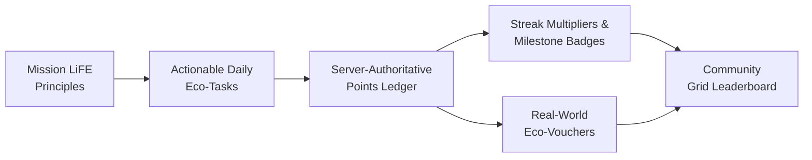
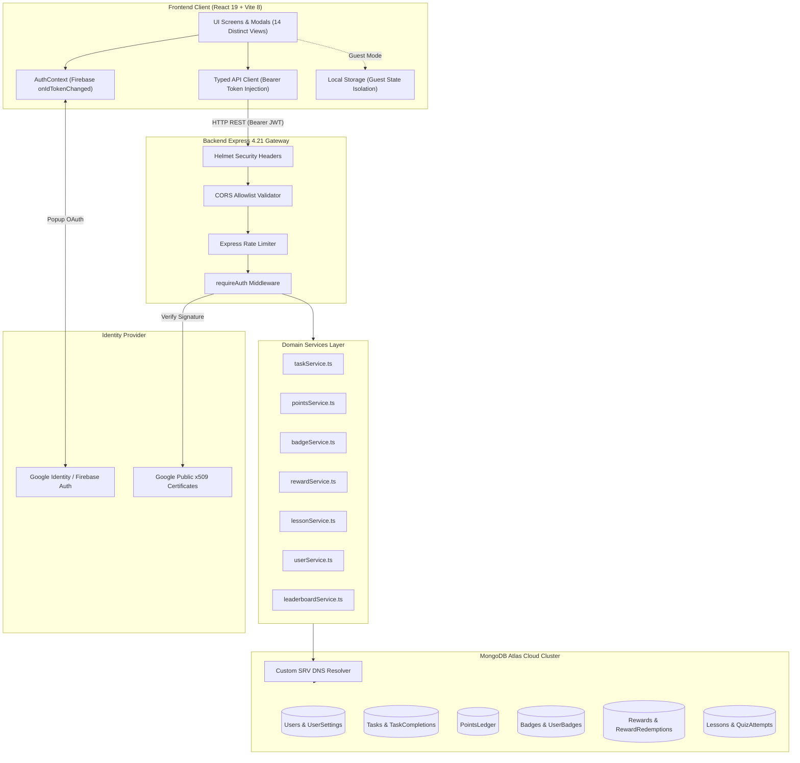
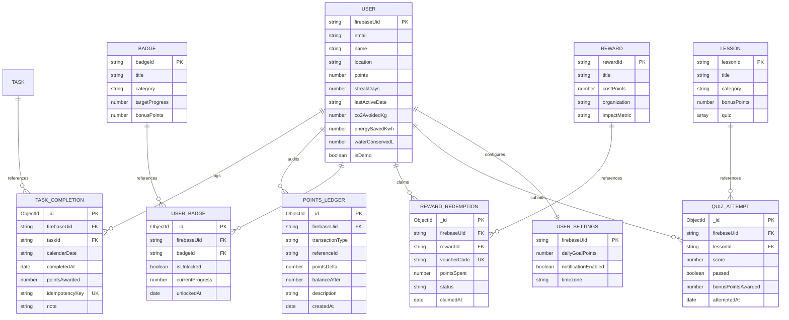

# GRIDSHIELD AI — Mission LiFE Citizen Engagement Platform

> **Interactive Climate Action & Eco-Habit Architecture for Sustainable Energy Living**  
> **Submitted for:** HackCult '26 | **Organisation:** Gujarat Energy Development Agency (GEDA)  
> **Problem Statement ID:** HC26-GEDA01 | **Track:** Green Energy & Sustainability | **Category:** Software  
> **Submission Deadline:** 4 November 2026, 6:30 PM IST

---

## 1. Project Header & Hackathon Context

| Field | Detail |
| :--- | :--- |
| **Project Name** | **GRIDSHIELD AI** |
| **Hackathon** | **HackCult '26** |
| **Organising Body** | **Gujarat Energy Development Agency (GEDA)** |
| **Problem Statement ID** | **HC26-GEDA01** |
| **Problem Statement** | **Development of an Interactive "Mission LiFE" Citizen Engagement Application** |
| **Theme / Track** | **Green Energy & Sustainability** |
| **Software Category** | **Full-Stack Web & Mobile-First Progressive Web Architecture** |
| **Current Readiness Status** | **🟢 READY FOR DEMO** *(Production Deployment Pending)* |

---

## 2. Project Links

> [!IMPORTANT]
> The following fields provide submission links. Deployment and video recording will be completed prior to the final submission deadline:

- **Live Application:** `PENDING DEPLOYMENT — LINK WILL BE ADDED`
- **GitHub Repository:** [https://github.com/ps06222005-oss/Project---Gridshield-](https://github.com/ps06222005-oss/Project---Gridshield-)
- **Demo Video:** `PENDING RECORDING — LINK WILL BE ADDED`
- **Pitch Deck PDF:** `PENDING — LINK WILL BE ADDED`

---

## 3. Problem Statement (HC26-GEDA01 Alignment)

As outlined by the **Gujarat Energy Development Agency (GEDA)** in problem statement **HC26-GEDA01**, accelerating the transition toward a low-carbon society requires active public participation through India's **Mission LiFE (Lifestyle for Environment)** framework. However, citizen adoption encounters fundamental obstacles:

1. **The Intangibility of Personal Impact**: Citizens struggle to comprehend how everyday micro-actions—such as setting air conditioners to 24°C, washing laundry in cold water, or eliminating phantom power loads—directly translate into avoided greenhouse gas emissions ($kg\text{ CO}_2\text{e}$) and reduced grid peak stress.
2. **Habit Attrition and Urgency Fatigue**: Sustainable habits require continuous positive reinforcement. Without immediate feedback loops, streak continuity, or social validation, enthusiasm rapidly wanes under eco-anxiety or guilt-driven messaging.
3. **Absence of Actionable, Accessible Tools**: Citizens lack intuitive digital platforms that bridge the gap between high-level climate awareness and concrete, step-by-step daily routines tailored to local energy realities.

---

## 4. Our Solution

**GRIDSHIELD AI** is a mobile-first digital stewardship platform that operationalises **Mission LiFE** into engaging, rewarding daily routines. Rather than relying on abstract carbon accounting, GRIDSHIELD AI structures citizen climate action into bite-sized micro-habits, verified micro-learning, and authentic community recognition.



### Core Solution Pillars:
- **Daily Eco-Habits**: Pre-calibrated energy, water, waste, and mobility actions with calculated impact labels (e.g., *Save 1.2 kWh/day*, *Conserve 45L Water*).
- **Server-Authoritative Ledger**: Points, daily streaks, badge criteria, and vouchers are evaluated exclusively on the server via atomic database operations to prevent client-side tampering.
- **Anti-Cheat Micro-Learning**: 3-minute sustainability modules with server-graded quizzes whose answers are stripped from public API payloads.
- **Dual-Tier Access**: A frictionless, zero-barrier **Guest Demo Mode** utilizing local browser isolation alongside persistent cloud accounts powered by **Firebase Google Authentication** and **MongoDB Atlas**.
- **Transparent Honor System**: Self-reported habit logging paired with optional verification notes, fostering intrinsic personal integrity without intrusive surveillance.

---

## 5. Features: Implemented vs. Planned

To maintain complete transparency for hackathon evaluators, all platform features are classified according to verified implementation in the source code:

| Feature | Category | Status | Verification & Source Location |
| :--- | :--- | :---: | :--- |
| **Guest Demo Mode** | Authentication | **Implemented** | `src/App.tsx`, isolated browser `localStorage` (`gridshield_user_state_v1`). |
| **Google Sign-In** | Authentication | **Implemented** | `src/context/AuthContext.tsx`, Firebase Web SDK + Admin token verification. |
| **Daily Recurring Tasks** | Task Engine | **Implemented** | `backend/src/services/taskService.ts`, enforces 1 completion/day per timezone. |
| **One-Time Milestone Tasks** | Task Engine | **Implemented** | `backend/src/models/Task.ts`, lifetime completion enforcement. |
| **Server-Authoritative Points Ledger** | Points & Ledger | **Implemented** | `backend/src/services/pointsService.ts`, atomic `$inc` mutations in MongoDB. |
| **Idempotency Protection** | Transactions | **Implemented** | `backend/src/models/TaskCompletion.ts`, unique index on `idempotencyKey`. |
| **Daily Streak Engine** | Gamification | **Implemented** | `backend/src/services/userService.ts`, consecutive day detection & gap reset. |
| **Milestone Badges (6 Levels & 8 Badges)** | Gamification | **Implemented** | `backend/src/services/badgeService.ts`, dynamic progress calculation. |
| **Sustainability Curriculum & Quizzes** | Education | **Implemented** | `backend/src/services/lessonService.ts`, server-side grading, answer stripping. |
| **Impact Catalog & Voucher Minting** | Rewards | **Implemented** | `backend/src/services/rewardService.ts`, unique code generator (`GRID-CAT-XXXX`). |
| **Community Leaderboard** | Community | **Implemented** | `backend/src/services/leaderboardService.ts`, filters real registered users. |
| **Account Deletion Cascade** | Privacy | **Implemented** | `backend/src/controllers/meController.ts`, cascades across 7 collections. |
| **Resilient DNS Fallback** | Infrastructure | **Implemented** | `backend/src/config/db.ts`, auto-resolves loopback DNS issues on Windows. |
| **Notification Settings Toggle** | Settings | **Partially Implemented** | UI toggle persists to `UserSettings`; backend push worker is planned. |
| **Weekly Leaderboard Historical Archives** | Community | **Partially Implemented** | Live leaderboard ranks all-time points; weekly snapshots require cron worker. |
| **AI-Powered Photo Habit Verification** | Verification | **Planned** | Computer vision verification using Gemini Vision models. |
| **Rooftop Solar Feasibility Calculator** | Energy Tools | **Planned** | Solar irradiance and payback calculator based on roof dimensions. |
| **Direct IoT Smart Meter Telemetry** | Verification | **Planned** | Hardware webhooks for automated domestic energy conservation telemetry. |
| **Vendor Marketplace Directory** | Ecosystem | **Planned** | Directory of verified local solar installers and composting vendors. |

*(Note: GRIDSHIELD AI uses self-reported habit logging with optional verification notes. It does not claim automated hardware-level IoT or satellite verification).*

---

## 6. Application Screenshots

The following verified screenshots were captured directly during automated Playwright browser test runs across both mobile (`390 x 844`) and desktop (`1280 x 800`) viewports:

| View / Screen | Viewport | Verified Repository Artifact Link |
| :--- | :---: | :--- |
| **Welcome Screen (Earth Hero & Node Selector)** | Mobile | [docs/screenshots/01_mobile_welcome_screen.png](docs/screenshots/01_mobile_welcome_screen.png) |
| **Home Dashboard & Live Grid Status** | Mobile | [docs/screenshots/02_mobile_home_dashboard.png](docs/screenshots/02_mobile_home_dashboard.png) |
| **Eco Tasks Screen & Category Filters** | Mobile | [docs/screenshots/03_mobile_tasks_screen.png](docs/screenshots/03_mobile_tasks_screen.png) |
| **Task Action Steps & Self-Report Modal** | Mobile | [docs/screenshots/04_mobile_task_modal.png](docs/screenshots/04_mobile_task_modal.png) |
| **Eco Badges Screen & Progress** | Mobile | [docs/screenshots/05_mobile_badges_screen.png](docs/screenshots/05_mobile_badges_screen.png) |
| **Badge Unlock Criteria Modal** | Mobile | [docs/screenshots/06_mobile_badge_modal.png](docs/screenshots/06_mobile_badge_modal.png) |
| **Community Leaderboard & Scope Toggle** | Mobile | [docs/screenshots/07_mobile_leaderboard_screen.png](docs/screenshots/07_mobile_leaderboard_screen.png) |
| **Micro-Learning Curriculum** | Mobile | [docs/screenshots/08_mobile_learn_screen.png](docs/screenshots/08_mobile_learn_screen.png) |
| **Lesson Reading & Takeaways Modal** | Mobile | [docs/screenshots/09_mobile_lesson_modal.png](docs/screenshots/09_mobile_lesson_modal.png) |
| **Server-Graded Quiz Result Modal** | Mobile | [docs/screenshots/10_mobile_quiz_result.png](docs/screenshots/10_mobile_quiz_result.png) |
| **Impact Rewards Catalog** | Mobile | [docs/screenshots/11_mobile_rewards_catalog.png](docs/screenshots/11_mobile_rewards_catalog.png) |
| **Claimed Green Vouchers Drawer** | Mobile | [docs/screenshots/12_mobile_vouchers_tab.png](docs/screenshots/12_mobile_vouchers_tab.png) |
| **Profile Screen & Grid Node Location** | Mobile | [docs/screenshots/13_mobile_profile_screen.png](docs/screenshots/13_mobile_profile_screen.png) |
| **User Activity History Feed** | Mobile | [docs/screenshots/14_mobile_activity_screen.png](docs/screenshots/14_mobile_activity_screen.png) |
| **Transparent Points History Ledger** | Mobile | [docs/screenshots/15_mobile_points_screen.png](docs/screenshots/15_mobile_points_screen.png) |
| **Settings & Daily Goal Thresholds** | Mobile | [docs/screenshots/16_mobile_settings_screen.png](docs/screenshots/16_mobile_settings_screen.png) |
| **Desktop Welcome Viewport (1280x800)** | Desktop | [docs/screenshots/18_desktop_welcome.png](docs/screenshots/18_desktop_welcome.png) |
| **Desktop Dashboard Viewport (1280x800)** | Desktop | [docs/screenshots/19_desktop_home_dashboard.png](docs/screenshots/19_desktop_home_dashboard.png) |

---

## 7. Technology Stack

### Frontend Client
- **Framework**: React 19.0.1 (`react`, `react-dom`)
- **Build Tool**: Vite 8.3.0 with `@tailwindcss/vite` 4.3.3
- **Language**: TypeScript 7.0.2 / 5.7
- **Styling**: Tailwind CSS 4 with custom warm cream (`#FFF9EC`) and matcha green (`#879B68`, `#556E40`) theme
- **Icons**: Lucide React 0.546.0
- **Animation**: Motion 12.23.24
- **Authentication**: Firebase Web SDK 11.0.2 (`firebase/auth`)

### Backend API Server
- **Runtime**: Node.js (v20+ supported; verified on v26.4.0)
- **Framework**: Express.js 4.21.2
- **Language**: TypeScript 5.7.2 (`tsx`, `tsc`)
- **Database Driver**: Mongoose 8.8.3 connecting to MongoDB Atlas
- **Authentication**: Firebase Admin SDK 12.7.0 (`firebase-admin`)
- **Security Middleware**: Helmet 8.0.0, CORS 2.8.5, Express Rate Limit 7.4.1
- **Request Validation**: Zod 3.23.8
- **OpenAPI Specification**: OpenAPI 3.0.3 (`backend/openapi.json` served at `/api/v1/docs`)

### Quality Assurance & Automated Testing
- **Unit & Integration Testing**: Vitest 2.1.8 with Supertest 7.0.0
- **Browser Automation**: Playwright 1.64.1 (Chromium mobile & desktop viewports)
- **Performance & Accessibility Auditing**: Google Lighthouse 13.6.0

---

## 8. System Architecture

The following diagram illustrates the flow of requests from the React client to external identity providers, API security middleware, business logic services, and the MongoDB Atlas cloud database:



---

## 9. Database Schema

GRIDSHIELD AI implements 11 normalized Mongoose schemas in MongoDB Atlas, linking user activity through their unique `firebaseUid`:



---

## 10. API Documentation

All API endpoints are prefixed with `/api/v1`. The complete OpenAPI 3.0 specification is available at `GET /api/v1/docs` on the running backend server.

| Method | Endpoint | Auth Required | Description |
| :--- | :--- | :---: | :--- |
| `GET` | `/health` | No | System health and MongoDB Atlas connectivity status. |
| `GET` | `/docs` | No | Serves the OpenAPI 3.0 specification JSON file. |
| `GET` | `/tasks` | No | Returns the public catalog of available eco-tasks. |
| `POST` | `/tasks/:taskId/complete` | **Yes (Bearer JWT)** | Validates daily recurrence, awards points, and updates impact stats. |
| `GET` | `/rewards` | No | Lists redeemable environmental impact rewards. |
| `POST` | `/rewards/:rewardId/redeem` | **Yes (Bearer JWT)** | Deducts points atomically and mints a unique voucher code. |
| `GET` | `/badges` | No | Returns achievement badges and unlock criteria. |
| `GET` | `/lessons` | No | Returns sustainability learning modules *(answers stripped)*. |
| `GET` | `/lessons/:lessonId/quiz` | No | Returns lesson quiz questions *(answers stripped)*. |
| `POST` | `/lessons/:lessonId/quiz/submit` | **Yes (Bearer JWT)** | Server-side quiz evaluation; awards bonus points on passing attempt. |
| `GET` | `/dashboard` | **Yes (Bearer JWT)** | Returns authenticated user profile, points, streaks, and today's tasks. |
| `GET` | `/leaderboard` | No | Returns ranked community standings (`period=all-time`). |
| `GET` | `/me` | **Yes (Bearer JWT)** | Retrieves user profile, settings, and activity history. |
| `PATCH` | `/me` | **Yes (Bearer JWT)** | Updates user settings, daily goal, location, or timezone. |
| `GET` | `/me/vouchers` | **Yes (Bearer JWT)** | Retrieves user's claimed vouchers and redemption status. |
| `DELETE`| `/me` | **Yes (Bearer JWT)** | Cascading deletion of account and all associated ledger records. |

---

## 11. Installation and Setup (Windows PowerShell)

### Prerequisites
- **Node.js**: v20.0.0 or higher (verified on Node.js v26.4.0)
- **Package Manager**: npm v10+
- **Git**: v2.40+
- **Cloud Database**: Free-tier MongoDB Atlas cluster (or local MongoDB 7.0+)
- **Authentication**: Firebase project with Google Sign-In enabled

---

### Step 1: Clone the Repository
```powershell
git clone https://github.com/ps06222005-oss/Project---Gridshield-.git
cd Project---Gridshield-
```

### Step 2: Install Dependencies
```powershell
# 1. Install frontend dependencies
npm install

# 2. Install backend dependencies
cd backend
npm install
cd ..
```

### Step 3: Environment Configuration
Create environment files from the provided templates:

**Frontend Environment (`.env` in repository root):**
```env
VITE_API_BASE_URL=http://localhost:4000/api/v1
VITE_FIREBASE_API_KEY=your-firebase-api-key
VITE_FIREBASE_AUTH_DOMAIN=your-project.firebaseapp.com
VITE_FIREBASE_PROJECT_ID=gridshield-ai
VITE_FIREBASE_STORAGE_BUCKET=your-project.appspot.com
VITE_FIREBASE_MESSAGING_SENDER_ID=your-sender-id
VITE_FIREBASE_APP_ID=your-app-id
```

**Backend Environment (`backend/.env`):**
```env
PORT=4000
NODE_ENV=development
MONGODB_URI=mongodb+srv://<user>:<password>@<cluster>.mongodb.net/gridshield?retryWrites=true&w=majority
FRONTEND_ORIGIN=http://localhost:3000
FIREBASE_PROJECT_ID=gridshield-ai
RATE_LIMIT_WINDOW_MS=900000
RATE_LIMIT_MAX=100
```

> [!TIP]
> **Windows DNS Resolution**: If Node.js defaults to `127.0.0.1` and fails MongoDB SRV lookups, the backend automatically resolves records via Cloudflare (`1.1.1.1`) and Google (`8.8.8.8`) DNS fallbacks.

### Step 4: Seed Database Catalogues
Populate the 8 tasks, 8 badges, 5 rewards, and 3 lessons into MongoDB Atlas:
```powershell
npm run seed --prefix backend
```

### Step 5: Start Development Servers
Open two separate PowerShell terminal windows:

**Terminal 1 — Backend API Server (Port 4000):**
```powershell
npm run dev --prefix backend
# Health verified at: http://localhost:4000/api/v1/health
```

**Terminal 2 — Frontend Client (Port 3000):**
```powershell
npm run dev
# App available at: http://localhost:3000
```

---

## 12. Testing and Quality Assurance

The application underwent rigorous multi-layer testing before submission:

```
══════════════════════════════════════════════════════════════
               TEST SUITE EXECUTION SUMMARY
══════════════════════════════════════════════════════════════
  Backend Automated Tests:   100 / 100 Passed (9 Test Suites)
  Frontend TypeScript Check: 0 Errors (tsc --noEmit)
  Backend TypeScript Build:  0 Errors (tsc into backend/dist)
  Frontend Production Build: 1,691 modules bundled in 2.51s
  Live System Integration:   16 / 16 Checks Passed (100%)
  Playwright Browser Steps:  11 / 11 Steps Passed (14 Screens)
══════════════════════════════════════════════════════════════
```

### Test Count Progression Clarification
Earlier Phase 4 integration runs reported **41 passing tests** focused strictly on the HTTP router (`tasksAndRewards.test.ts` and `health.test.ts`). In Phase 5 and Phase 6, comprehensive unit test suites were added covering schemas, points transactions, DNS resolution, streaks, and quiz anti-cheat, expanding the automated regression suite to **100 tests across 9 suites**:

- `src/tests/unit/schemas.test.ts` (15 tests)
- `src/tests/unit/pointsService.test.ts` (8 tests)
- `src/tests/unit/ecoLogic.test.ts` (7 tests)
- `src/tests/unit/dns.test.ts` (6 tests)
- `src/tests/unit/taskService.test.ts` (6 tests)
- `src/tests/unit/streakAndQuiz.test.ts` (6 tests)
- `src/tests/integration/liveHttpServer.test.ts` (6 tests)
- `src/tests/integration/health.test.ts` (8 tests)
- `src/tests/integration/tasksAndRewards.test.ts` (38 tests)
- **Total:** **100 / 100 automated tests passed** in 6.81s.

### Google Lighthouse Quality Audit (Production Bundle)
- **Accessibility:** **100 / 100** (WCAG 2.1 AA compliant, color contrast $\ge 5.69:1$, accessible label-in-name compliance)
- **Best Practices:** **100 / 100** (Zero browser console errors, secure headers, clean HTTPS/origin boundaries)
- **SEO:** **100 / 100** (Valid viewport, meta descriptions, and crawler policy in `public/robots.txt`)
- **Performance:** **72 / 100** (Mobile simulated 4G on production bundle)

---

## 13. Security Considerations

*(Passed tested security scenarios against common web attack vectors; does not represent a third-party penetration-test certification).*

1. **Server-Authoritative Balances**: The frontend client never increments or computes authoritative point balances. Points, badges, and vouchers are minted exclusively within atomic backend database transactions (`$inc`).
2. **Cryptographic Token Verification**: Protected endpoints verify RS256 JWT signatures against Google's public x509 certificates. Unauthorized or expired tokens are rejected with HTTP 401.
3. **Idempotency Protection**: Critical operations enforce unique idempotency keys in MongoDB, preventing accidental double-awarding from rapid clicks or network retries.
4. **Anti-Cheat Quiz Delivery**: `correctAnswerIndex` is stripped from quiz objects before transmission to the browser. Grading is performed entirely on the server.
5. **Security Headers & CORS**: Helmet applies strict HTTP security headers (`nosniff`, `hidePoweredBy()`). CORS validates incoming requests against an explicit frontend allowlist.
6. **Credential Hygiene**: All environment files are excluded from Git via `.gitignore`. No hardcoded secrets exist in the repository.

---

## 14. Approach and Design Decisions

- **Why Gamification?**: Extrinsic incentives (points, levels, streaks, badges) provide immediate reinforcement during early habit formation, gradually transitioning into intrinsic environmental consciousness without triggering eco-fatigue or carbon guilt.
- **Micro-Actions Philosophy**: Aligning with Mission LiFE, individual action is most effective when broken down into achievable daily choices rather than overwhelming lifestyle disruptions.
- **Server-Side Authoritative Calculations**: Prevents client-side manipulation of points and leaderboards, ensuring that achievements and vouchers reflect genuine, rule-compliant habit completions.
- **Guest vs. Authenticated Isolation**: Lowers the barrier to entry by allowing citizens to explore the app immediately without forced sign-in, while maintaining strict data separation from authenticated cloud profiles.

---

## 15. Known Limitations

- **Self-Reported Task Completion**: Tasks operate on an honor system with optional reflection notes; there is currently no automated IoT or smart-meter telemetry.
- **Empirical Impact Estimates**: Environmental metrics ($0.98\text{ kg CO}_2\text{e}$ per AC setpoint, $45\text{ L}$ water per mindful shower) are calculated using published urban averages rather than live utility sensors.
- **Push Notification Background Worker**: The notification toggle persists to user settings, but background Web Push dispatch is not yet connected to a server worker.
- **All-Time Leaderboard**: The leaderboard calculates ranks based on all-time points; time-bucketed weekly snapshots require a recurring cron worker.
- **Rooftop Solar Feasibility**: A dedicated rooftop solar calculator is not implemented in the current prototype.

---

## 16. Scalability and Future Roadmap

- [ ] **AI-Powered Photo Verification**: Integration with Gemini Vision to verify photos of compost bins, reusable bags, and thermostat setpoints.
- [ ] **Rooftop Solar Feasibility Tool**: Solar irradiance, rooftop area, and capital payback estimation tool tailored to Gujarat solar tariffs.
- [ ] **Smart Meter & Home Automation Telemetry**: Direct API integration with smart plugs and thermostats (Google Nest, Ecobee) for automatic energy conservation verification.
- [ ] **Municipal Multi-Tenancy**: Administrative dashboards for municipal corporations and universities to host localized green challenges.
- [ ] **Decentralized Climate Credentials**: Exporting verified citizen achievements as verifiable digital credentials or localized carbon credits.

---

## 17. Hackathon Submission Checklist

- [x] Public GitHub repository accessible to judges.
- [x] All hackathon-window commits pushed to GitHub.
- [x] Comprehensive, honest technical README documentation.
- [ ] Working deployed application URL — *(Pending manual deployment update)*.
- [ ] 2–3 minute unlisted YouTube/Loom demo recording — *(Pending recording update)*.
- [ ] Pitch deck PDF (maximum 10 slides) — *(Pending final slide export)*.
- [x] Architecture diagram (Mermaid).
- [x] Database schema & ER diagram (Mermaid).
- [x] Accurate PowerShell setup instructions.
- [x] Verified test results and Google Lighthouse scorecard.
- [x] Zero exposed credentials or API secrets.

---

## 18. Project Status and License

- **Project Status**: **🟢 READY FOR DEMO** *(Production Deployment Pending)*.
  - Core backend REST API, database schemas, points ledger, and 100/100 automated tests passed.
  - Full frontend UI across 14 screens/modals, guest isolation, and API integration verified.
  - Google Lighthouse scores of 100 Accessibility, 100 Best Practices, and 100 SEO verified on production bundle.
  - Production deployment (custom domain, TLS, CDN edge caching) documented as pending.
- **License**: Not specified (Proprietary / All rights reserved until formally licensed).

---

*Developed with commitment for Mission LiFE, sustainable energy transition, and Gujarat Energy Development Agency (GEDA) initiatives at HackCult '26.*
